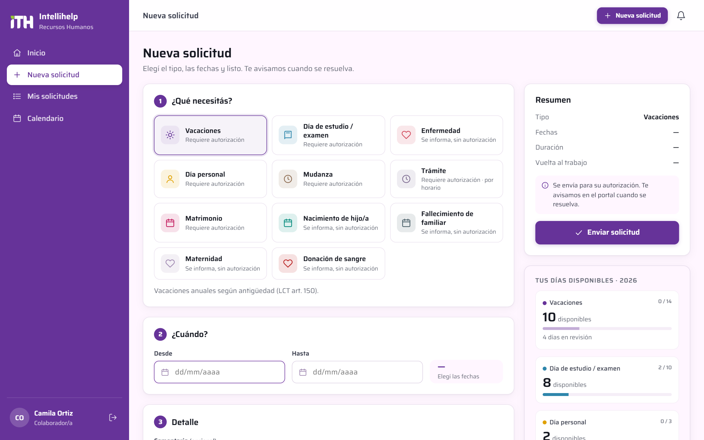
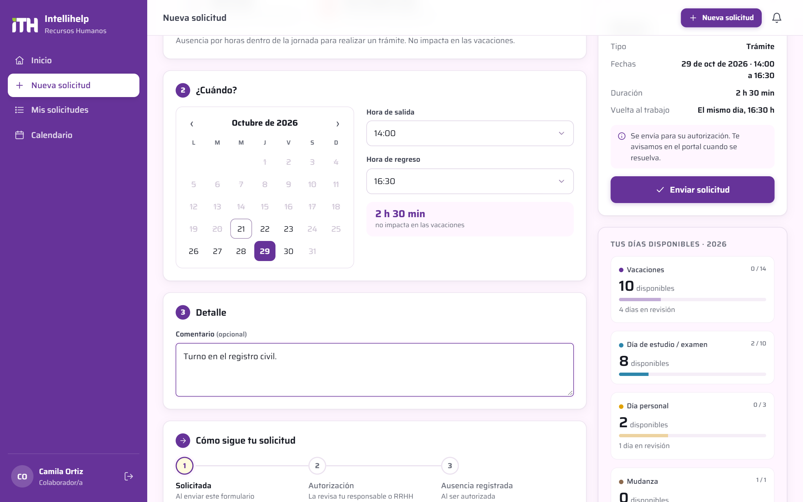
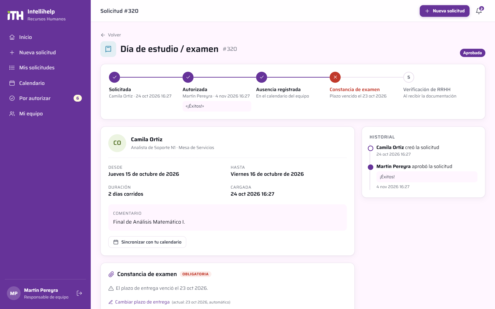
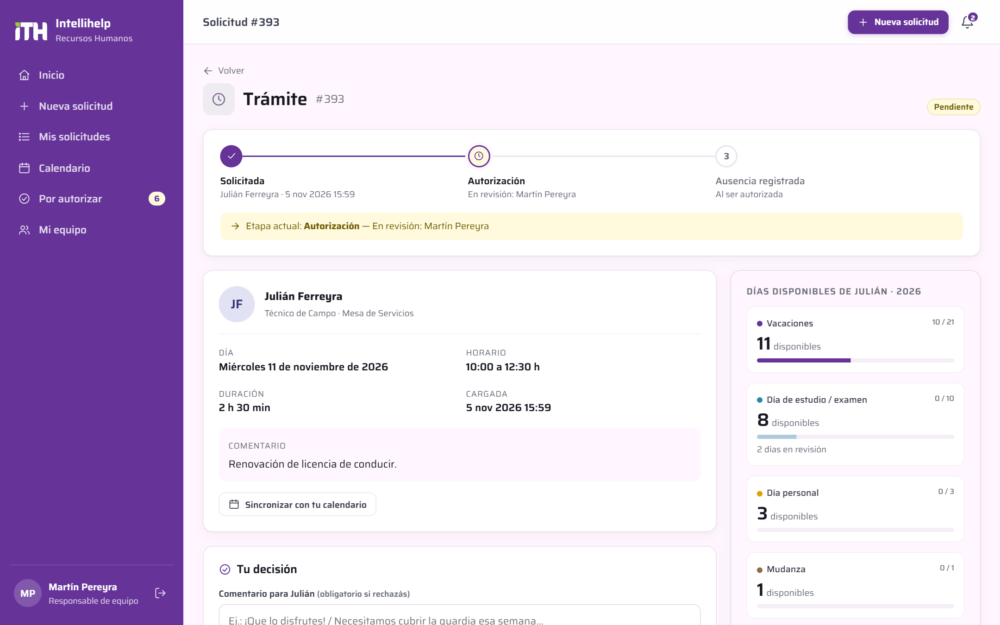
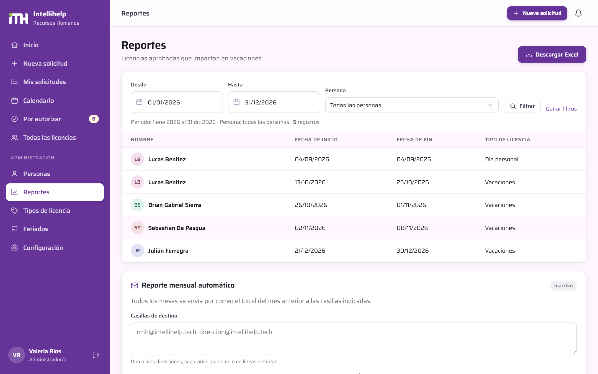
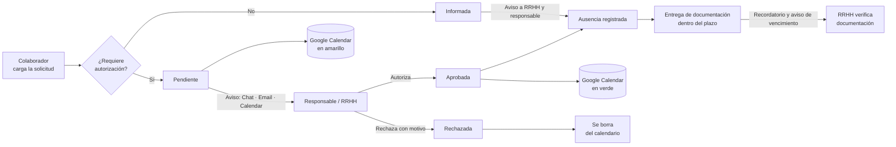

<p align="center">
  
</p>

<p align="center">
  
  
  
  
  
  
</p>

<p align="center">
  <b><a href="https://rrhh.intellihelp.tech">rrhh.intellihelp.tech</a></b>
</p>

---

## Descripción

**Portal de Recursos Humanos de Intellihelp**: plataforma interna para solicitar, aprobar y registrar vacaciones, días de estudio, licencias por enfermedad y demás ausencias del personal, incluido el personal tercerizado.

Reemplaza los pedidos por mail o mensajería por un circuito único y trazable:

- el colaborador **pide** desde el portal (también desde el celular);
- quien autoriza **recibe el aviso** por Google Chat, email y Google Calendar;
- **autoriza o rechaza** con un clic y el colaborador recibe la respuesta;
- todo queda **registrado** con historial, días disponibles y documentación respaldatoria.

Las licencias que no requieren autorización (por ejemplo, enfermedad) se **informan**, y el certificado médico es **obligatorio** para poder enviarlas.

## Índice

- [Capturas](#capturas)
- [Funcionalidades](#funcionalidades)
- [Circuito de una solicitud](#circuito-de-una-solicitud)
- [Notificaciones](#notificaciones)
- [Arquitectura](#arquitectura)
- [Seguridad](#seguridad)
- [Instalación y despliegue](#instalación-y-despliegue)
- [Configuración](#configuración)
- [Autor](#autor)

## Capturas

> Las capturas usan datos ficticios de demostración.

### Ingreso

<p align="center"></p>

### Inicio — vista del responsable

Solicitudes por autorizar, ausentes del día y próximos 14 días, y días disponibles propios.

<p align="center"></p>

### Nueva solicitud

Tres pasos: qué se necesita, cuándo y un detalle opcional. Calcula los días (corridos o hábiles, descontando feriados), la fecha de regreso y valida los días disponibles. Al final, el mapa **«Cómo sigue tu solicitud»** muestra las etapas del tipo elegido. La documentación no se adjunta al pedir: se entrega después, como una etapa más.

<p align="center"></p>

<table>
  <tr>
    <td width="50%"><b>Calendario de selección de fechas</b><br></td>
    <td width="50%"><b>Trámite por horario</b><br></td>
  </tr>
</table>

### Seguimiento y decisión

Cada solicitud muestra su **seguimiento por etapas** (solicitada, autorización, ausencia registrada, documentación y verificación), con la etapa actual destacada. Junto a la decisión se ven los días disponibles del colaborador, las superposiciones con el equipo y el **plazo de entrega de la documentación**, automático o elegido por quien autoriza.

<p align="center"></p>

<table>
  <tr>
    <td width="50%"><b>Por autorizar</b><br></td>
    <td width="50%"><b>Enfermedad informada con certificado pendiente</b><br></td>
  </tr>
  <tr>
    <td width="50%"><b>Constancia de examen con plazo de entrega</b><br></td>
    <td width="50%"><b>Trámite pendiente de autorización</b><br></td>
  </tr>
  <tr>
    <td width="50%"><b>Calendario del equipo</b><br></td>
    <td width="50%"><b>Todas las licencias (filtros y exportación CSV)</b><br></td>
  </tr>
  <tr>
    <td width="50%"><b>Personas</b><br></td>
    <td width="50%"><b>Tipos de licencia configurables</b><br></td>
  </tr>
</table>

### Reportes (administradores)

Licencias aprobadas que impactan en vacaciones, con filtros por período y persona, **descarga en Excel con formato de tabla** y envío mensual automático por correo.

<p align="center"></p>

### Celular

<p align="center">
  
  &nbsp;
  
  &nbsp;
  
</p>

### Email de notificación

<p align="center"></p>

## Funcionalidades

### Colaboradores
- Solicitud de **vacaciones, días de estudio/examen, día personal, trámites, mudanza, matrimonio, nacimiento, fallecimiento, maternidad, donación de sangre** y **enfermedad**.
- **Trámites por horario**: día en un calendario y horario de salida y regreso; no impactan en las vacaciones.
- Cálculo automático de días **corridos o hábiles**, descontando fines de semana y **feriados nacionales**.
- **Días disponibles** por tipo de licencia; vacaciones calculadas según antigüedad conforme a la **LCT (art. 150)**: 14, 21, 28 o 35 días.
- Solo las vacaciones descuentan días de vacaciones; en el **día personal**, quien autoriza decide si se descuenta.
- La documentación (certificados y constancias) se entrega **después** de pedir la licencia: una vez autorizada o, si solo se informa, cuando se tenga, dentro de un **plazo** con recordatorio previo.
- Validaciones: superposición de fechas, topes anuales y por solicitud, anticipación sugerida.
- Entrega de **certificados y constancias** en PDF o foto, también desde la cámara del celular.
- Historial completo, cancelación de solicitudes y notificaciones dentro del portal.
- Calendario personal suscribible (iCal).

### Responsables y Recursos Humanos
- Bandeja **Por autorizar** con aprobación en un clic; el rechazo exige un motivo.
- **Descuento opcional de vacaciones** en el día personal, validando los días disponibles del colaborador.
- Alerta de **superposición** con otras ausencias del equipo o del área.
- Verificación u **observación de documentación**; una observación otorga un nuevo plazo de 2 días hábiles.
- **Plazos de entrega de documentación** en días hábiles: automáticos según el tipo de licencia (contados desde el fin de la licencia o desde que se informa, nunca antes de que termine) o fijados por quien autoriza; aviso al colaborador antes del vencimiento y aviso al responsable y RRHH si vence.
- **Calendario** mensual de ausencias y listado general con **filtros y exportación CSV**.
- **Recordatorios automáticos** de solicitudes pendientes.
- Carga de licencias en nombre de un colaborador (con aprobación directa opcional).

### Administración
- Alta de **personas** con rol, responsable directo, área, empresa, fecha de ingreso y días de vacaciones manuales opcionales.
- **Autoregistro** de colaboradores: los correos del dominio corporativo se activan solos; los de **personal tercerizado** quedan pendientes de aprobación por RRHH.
- **Tipos de licencia** configurables: autorización, documentación obligatoria y su plazo de entrega, topes, forma de conteo, descuento de vacaciones y color.
- **Reportes** (solo administradores): exportación a Excel de las licencias que impactan en vacaciones y envío mensual automático a una o más casillas.
- **Feriados** editables por año.
- Configuración de **canales de notificación** con pruebas integradas (email, Google Chat, Google Calendar).

### Roles

| Rol | Alcance |
|---|---|
| Colaborador/a | Pide y consulta sus propias licencias |
| Responsable de equipo | Autoriza a su equipo y ve su calendario |
| Recursos Humanos | Ve y autoriza todo, verifica documentación, administra personas y tipos |
| Administrador/a | Todo lo anterior más la configuración del sistema y los reportes |

## Circuito de una solicitud



| Estado | Significado | En Google Calendar |
|---|---|---|
| Pendiente | Espera la decisión del responsable | 🟡 `⏳ [Pendiente] Tipo — Persona` |
| Aprobada | Autorizada (indica si se descontó de vacaciones) | 🟢 `Tipo — Persona` |
| Informada | Licencia sin autorización (ej. enfermedad) | 🟣 `Tipo — Persona` |
| Rechazada / Cancelada | Sin efecto | Se elimina |

## Notificaciones

| Canal | Destinatarios | Contenido |
|---|---|---|
| **Portal** | Todos | Avisos con acceso directo a la solicitud |
| **Email** | Colaborador, aprobadores y casilla de RRHH | Detalle de la solicitud, botón de acción e invitación `.ics` |
| **Google Chat** | Espacio de aprobadores | Nuevas solicitudes, licencias informadas, certificados, decisiones y recordatorios |
| **Google Calendar** | Calendario compartido de licencias | Evento por solicitud, actualizado según el estado |

La integración con Google Calendar usa una **cuenta de servicio** con **delegación de todo el dominio**, por lo que no requiere compartir el calendario con cuentas externas a la organización.

## Arquitectura

Aplicación **PHP 8.3 sin framework**, pensada para hosting compartido: sin procesos residentes ni dependencias de compilación.

```
├── app/                    # Fuera del docroot (no accesible desde la web)
│   ├── bootstrap.php       # Carga de configuración y librerías
│   ├── routes.php          # Rutas y despacho
│   ├── controllers/        # Autenticación, registro, solicitudes, calendario, perfil, administración
│   ├── lib/
│   │   ├── leave.php       # Reglas de negocio: conteo de días, vacaciones LCT, etapas, validaciones
│   │   ├── notify.php      # Orquestación de notificaciones por evento
│   │   ├── gcal.php        # Cliente de Google Calendar (JWT de cuenta de servicio)
│   │   ├── reports.php     # Reportes de vacaciones en Excel y envío mensual
│   │   ├── mailer.php      # Envío SMTP y plantilla de email
│   │   ├── gchat.php       # Notificaciones a Google Chat
│   │   ├── http.php        # Cliente HTTP (cURL)
│   │   ├── ics.php         # Invitaciones y feeds iCalendar
│   │   └── whatsapp.php    # Conectores opcionales de WhatsApp
│   ├── views/              # Plantillas PHP
│   ├── sql/                # Esquema, datos iniciales y migraciones idempotentes
│   ├── cron.php            # Recordatorios y resincronización
│   └── install.php         # Instalador por línea de comandos
├── public_html/            # Docroot: front controller, .htaccess y assets (ui.js: calendario y listas)
└── docs/                   # Banner y capturas
```

| Capa | Tecnología |
|---|---|
| Backend | PHP 8.3 (PDO, cURL, OpenSSL, fileinfo) |
| Base de datos | MariaDB 11 / MySQL 8 |
| Email | PHPMailer (SMTP de Google Workspace) |
| Reportes | PhpSpreadsheet (Excel con formato de tabla) |
| Integraciones | Google Calendar API, Google Chat Webhooks, iCalendar |
| Frontend | HTML + CSS propio + JavaScript sin dependencias |
| Identidad | Tipografía Saira · paleta `#663399` · `#9f88b1` · `#fff6ff` · `#fffade` · colores planos |

## Seguridad

- Contraseñas con `password_hash` (bcrypt/argon) y política de complejidad.
- Protección **CSRF** en todos los formularios y cookies de sesión `HttpOnly`, `Secure` y `SameSite`.
- Consultas **parametrizadas** (PDO) y escape de salida en todas las vistas.
- **Bloqueo por intentos fallidos** de ingreso y de recuperación de contraseña.
- Certificados almacenados **fuera del docroot**, servidos solo a usuarios autorizados, con validación de tipo MIME y tamaño.
- **Secretos cifrados** en base de datos (AES-256-GCM): contraseña SMTP, clave de la cuenta de servicio, webhooks.
- Validación de correo por enlace en el autoregistro y aprobación manual para dominios externos.
- HTTPS forzado, HSTS y cabeceras `X-Frame-Options`, `X-Content-Type-Options` y `Referrer-Policy`.

## Instalación y despliegue

### Requisitos
- PHP 8.2+ con `pdo_mysql`, `curl`, `openssl`, `mbstring`, `fileinfo`
- MariaDB 10.6+ o MySQL 8
- Composer

### Pasos

```bash
# 1. Subir app/ y public_html/ al servidor
#    (public_html/ como docroot; app/ al mismo nivel, fuera de la web)

# 2. Configuración
cp app/config.sample.php app/config.php
#    completar credenciales de base de datos y app_key (64 caracteres hex):
php -r "echo bin2hex(random_bytes(32)), PHP_EOL;"

# 3. Dependencias
cd app && composer install --no-dev

# 4. Base de datos y usuario administrador (idempotente: también aplica migraciones)
php install.php "Nombre Apellido" admin@intellihelp.tech
```

### Tarea programada

Ejecutar cada hora (en hPanel: **Avanzado → Cron Jobs**):

```
/usr/bin/php /home/<usuario>/domains/rrhh.intellihelp.tech/app/cron.php
```

Envía recordatorios de solicitudes pendientes y reintenta la sincronización con Google Calendar.

## Configuración

Todo se configura desde **Administración → Configuración**, sin tocar código:

| Sección | Parámetros |
|---|---|
| General | Nombre de la empresa, correo de soporte, casilla de RRHH, aprobador por defecto, frecuencia de recordatorios |
| Registro | Habilitar autoregistro, dominios de confianza |
| Email | Servidor SMTP, remitente, alcance de los avisos |
| Google Calendar | ID del calendario, clave JSON de la cuenta de servicio, usuario a representar |
| Google Chat | Webhook del espacio de aprobadores |

<details>
<summary><b>Configurar Google Calendar</b></summary>

1. En Google Cloud: crear un proyecto, habilitar **Google Calendar API** y crear una **cuenta de servicio** con clave JSON.
2. En la Consola de administración de Google Workspace: **Seguridad → Controles de API → Delegación de todo el dominio**, autorizar el *Client ID* de la cuenta de servicio con el permiso `https://www.googleapis.com/auth/calendar`.
3. Crear el calendario compartido de licencias y compartirlo con quienes autorizan.
4. En el portal: cargar el ID del calendario, la clave JSON y el usuario dueño del calendario en «Actuar en nombre de».
5. **Probar Google Calendar** crea un evento de prueba; después de verlo en el calendario, **Finalizar test** lo elimina.

</details>

<details>
<summary><b>Configurar Google Chat</b></summary>

1. Crear un espacio (por ejemplo, «RRHH – Aprobaciones») y sumar a quienes autorizan.
2. En el espacio: **Apps e integraciones → Webhooks → Agregar webhook** y copiar la URL.
3. Pegarla en el portal y usar **Probar Google Chat**.

</details>

## Autor

**Brian Gabriel Sierra**
Jefe de Sistemas e Infraestructura IT — Intellihelp

[](https://www.linkedin.com/in/brian-gabriel-sierra)

---

<p align="center">
  <sub>© 2026 Intellihelp · Software de uso interno. Todos los derechos reservados.</sub>
</p>
