<p align="center">
  
</p>

<p align="center">
  
  
  
  
  
  
</p>

<p align="center">
  <b><a href="https://rrhh.intellihelp.tech">rrhh.intellihelp.tech</a></b>
</p>

---

## Descripción

**Portal de Recursos Humanos de Intellihelp**: plataforma interna para solicitar, aprobar y registrar vacaciones, días de estudio, licencias por enfermedad y demás ausencias del personal, incluido el personal tercerizado.

Reemplaza los pedidos por mail o mensajería por un circuito único y trazable:

- el colaborador **pide** desde el portal (también desde el celular);
- quien autoriza **recibe el aviso** por Google Chat, email y Google Calendar;
- **autoriza o rechaza** con un clic y el colaborador recibe la respuesta;
- todo queda **registrado** con historial, días disponibles y documentación respaldatoria.

Las licencias que no requieren autorización (por ejemplo, enfermedad) se **informan**, y el certificado médico es **obligatorio** para poder enviarlas.

## Índice

- [Capturas](#capturas)
- [Funcionalidades](#funcionalidades)
- [Circuito de una solicitud](#circuito-de-una-solicitud)
- [Notificaciones](#notificaciones)
- [Arquitectura](#arquitectura)
- [Seguridad](#seguridad)
- [Instalación y despliegue](#instalación-y-despliegue)
- [Configuración](#configuración)
- [Autor](#autor)

## Capturas

> Las capturas usan datos ficticios de demostración.

### Ingreso

<p align="center">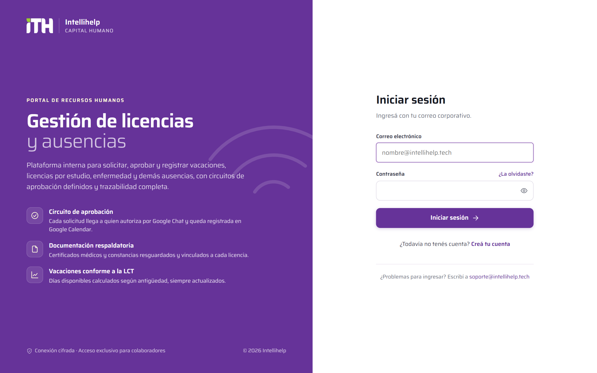</p>

### Inicio — vista del responsable

Solicitudes por autorizar, ausentes del día y próximos 14 días, y días disponibles propios.

<p align="center">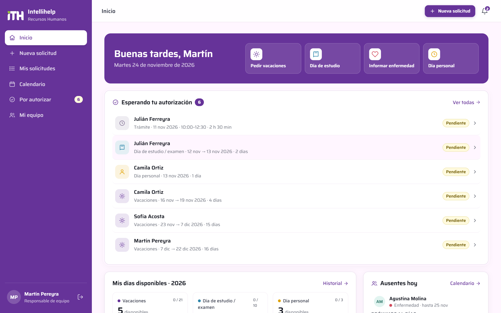</p>

### Nueva solicitud

Tres pasos: qué se necesita, cuándo y un detalle opcional. Calcula los días (corridos o hábiles, descontando feriados), la fecha de regreso y valida los días disponibles. Al final, el mapa **«Cómo sigue tu solicitud»** muestra las etapas del tipo elegido. La documentación no se adjunta al pedir: se entrega después, como una etapa más.

<p align="center">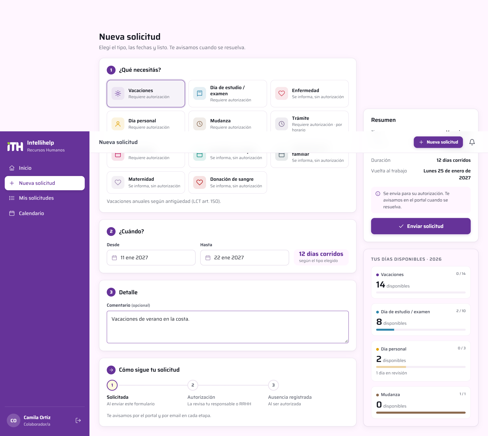</p>

<table>
  <tr>
    <td width="50%"><b>Calendario de selección de fechas</b><br>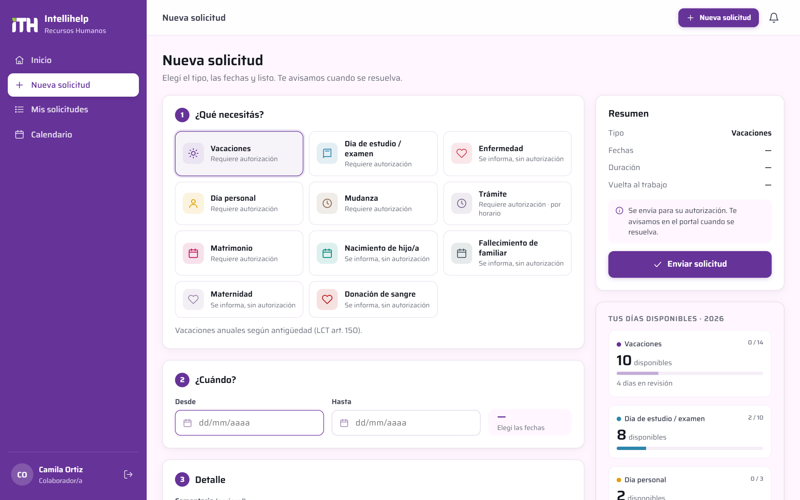</td>
    <td width="50%"><b>Trámite por horario</b><br>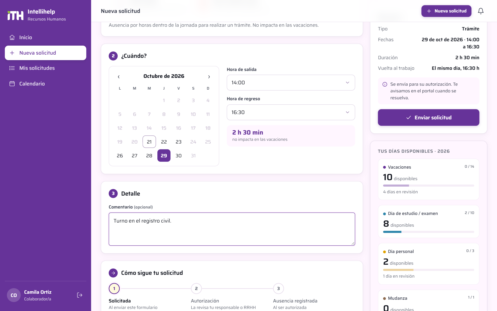</td>
  </tr>
</table>

### Seguimiento y decisión

Cada solicitud muestra su **seguimiento por etapas** (solicitada, autorización, ausencia registrada, documentación y verificación), con la etapa actual destacada. Junto a la decisión se ven los días disponibles del colaborador, las superposiciones con el equipo y el **plazo de entrega de la documentación**, automático o elegido por quien autoriza.

<p align="center">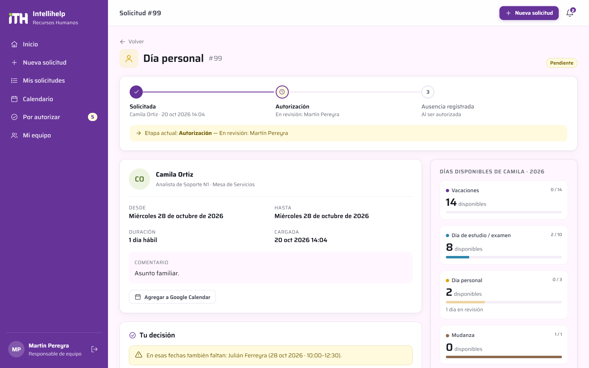</p>

**Vacaciones por semanas completas.** El período habitual es de 7 días corridos, de lunes a domingo. Una semana está completa cuando cada día de lunes a viernes fue pedido o es feriado, y en ese caso la licencia termina siempre el domingo:
- Los feriados posteriores a los días pedidos cuentan como vacaciones. Por ejemplo, de lunes a jueves con el viernes feriado se computan 7 días.
- Las vacaciones empiezan el lunes o, si es feriado, el siguiente día hábil (LCT art. 151). Los feriados del inicio no cuentan, aunque se elijan como primer día, y se cuentan 7 días corridos desde el primer día hábil (art. 154): con el lunes feriado van de martes a lunes.
- Una solicitud puede cruzar de diciembre a enero; los días se imputan al año en que empieza.

Los pedidos fuera del período habitual, como días sueltos, una semana y unos días o un inicio a mitad de semana, se pueden cargar como excepción con una doble confirmación. La primera pregunta «¿Estás seguro/a?». La segunda pide comunicarse antes con quienes autorizan las excepciones y muestra su teléfono, WhatsApp y correo. La solicitud queda marcada y quien autoriza decide si computa solo esos días o la semana completa.

<table>
  <tr>
    <td width="50%">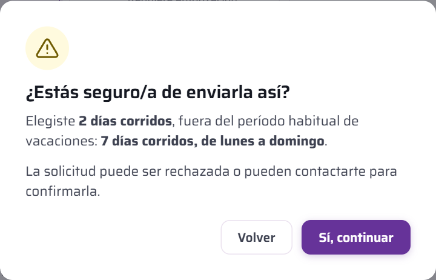</td>
    <td width="50%">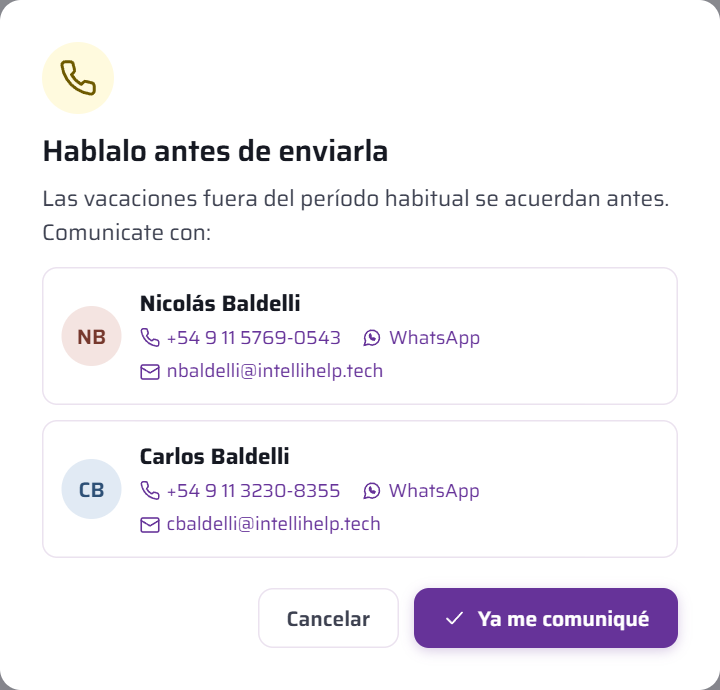</td>
  </tr>
</table>

**Vacaciones según la LCT.**
- **Aviso (art. 154):** la fecha de inicio se notifica con 30 días de anticipación, o 60 para quien está en el convenio de Comercio (CCT 130/75), que se indica en la ficha de cada persona según su puesto. El calendario arranca en esa fecha. RRHH puede cargarlas con menos anticipación, con advertencia, y si se autorizan con menos margen queda registrado en el historial.
- **Período (art. 154):** se otorgan entre el 1 de octubre y el 30 de abril. Fuera de ese período se avisa que es de común acuerdo, y la autorización lo registra.
- **Verano cada 3 años (art. 154):** el portal detecta a quién le corresponden vacaciones en verano (del 21/12 al 21/3) porque no las tuvo en los dos veranos anteriores. Unas vacaciones cuentan como de verano si al menos la mitad de sus días cae en esa temporada, estén autorizadas o pendientes. Se lo avisa a la persona al pedirlas y en su inicio, y RRHH ve la lista en su panel. Los veranos anteriores al portal se cargan en la ficha.
- **Menos de medio año (art. 153):** quien ingresó en el año y no llega a la mitad de los días hábiles tiene un día cada 20 días hábiles trabajados.
- **Acumulación (art. 164):** RRHH registra en la ficha el acuerdo para pasar hasta un tercio de las vacaciones al año siguiente, y esos días se suman a los disponibles del año próximo.
- **Enfermedad durante las vacaciones:** se puede informar aunque la persona esté de vacaciones. Las vacaciones terminan el día anterior y los días restantes quedan para reprogramar, sin completar la semana, hasta el 30 de abril siguiente. Se avisa a la persona, a quien autoriza y a RRHH.
- **Pago (arts. 156 y 162):** las vacaciones no se pagan en dinero. Al cargar la fecha de egreso, la ficha calcula los días a liquidar: el proporcional del año y, si el egreso es antes del 31 de mayo, los no gozados del año anterior.

<table>
  <tr>
    <td width="50%"><b>Ficha: vacaciones según la ley</b><br>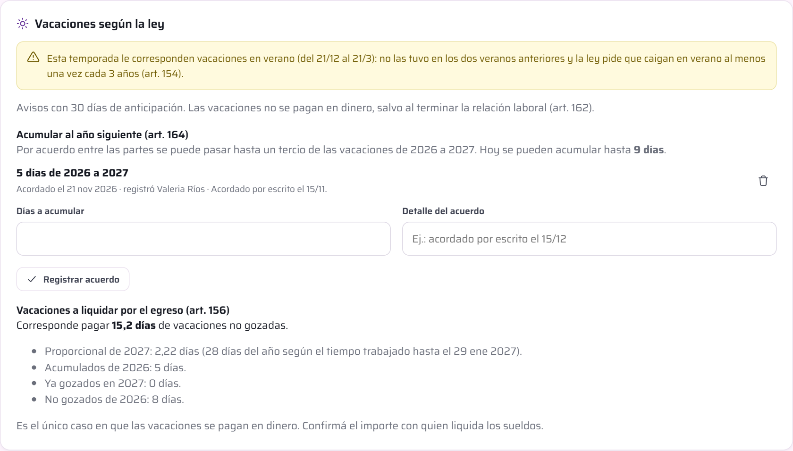</td>
    <td width="50%"><b>Vacaciones en verano (RRHH)</b><br>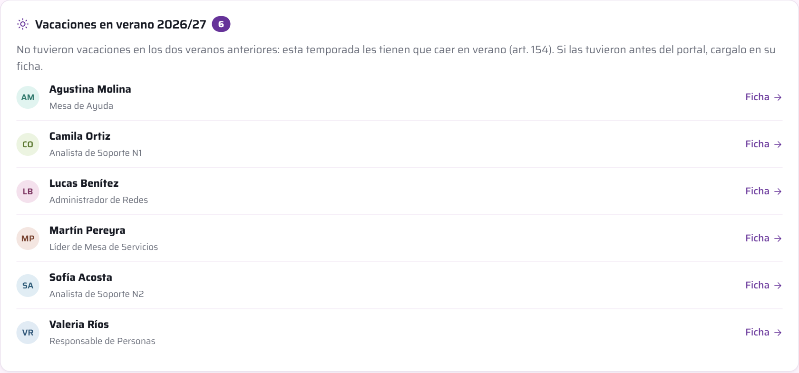</td>
  </tr>
</table>

<p align="center">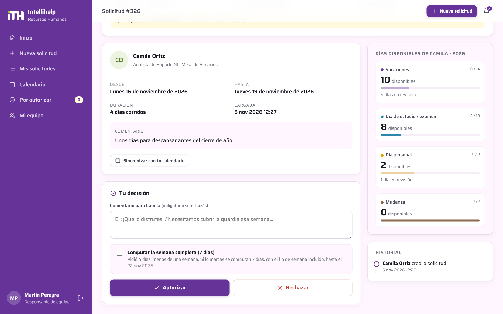</p>

<table>
  <tr>
    <td width="50%"><b>Por autorizar</b><br>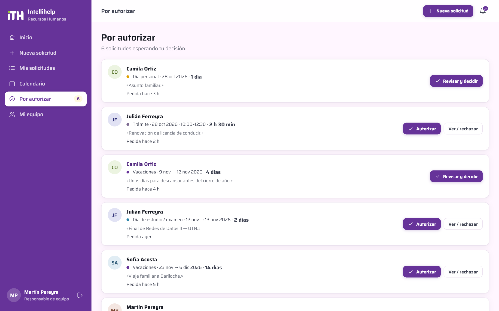</td>
    <td width="50%"><b>Enfermedad informada con certificado pendiente</b><br>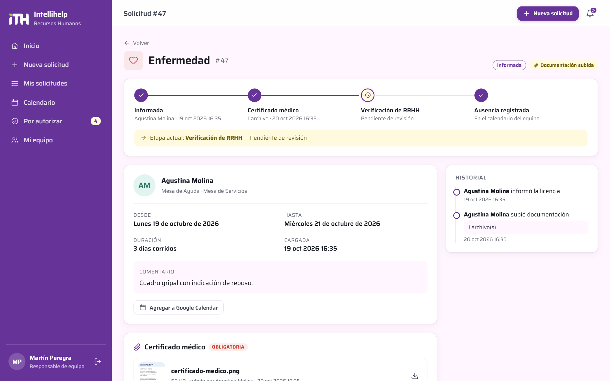</td>
  </tr>
  <tr>
    <td width="50%"><b>Constancia de examen con plazo de entrega</b><br>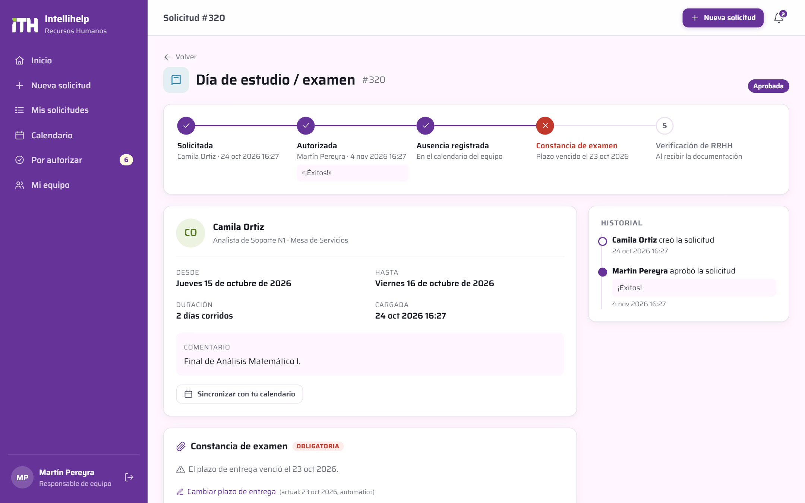</td>
    <td width="50%"><b>Trámite pendiente de autorización</b><br>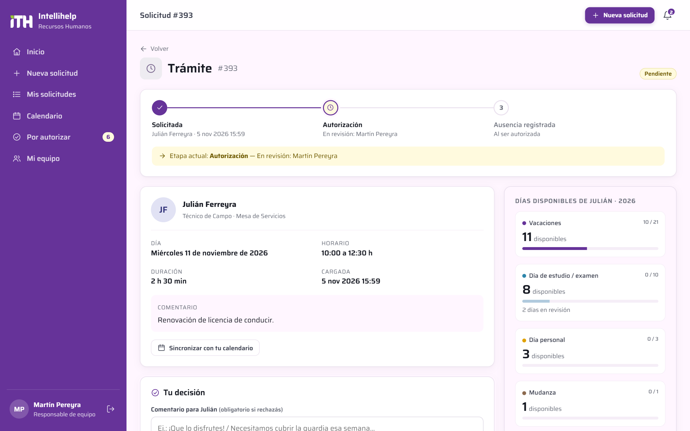</td>
  </tr>
  <tr>
    <td width="50%"><b>Calendario del equipo</b><br>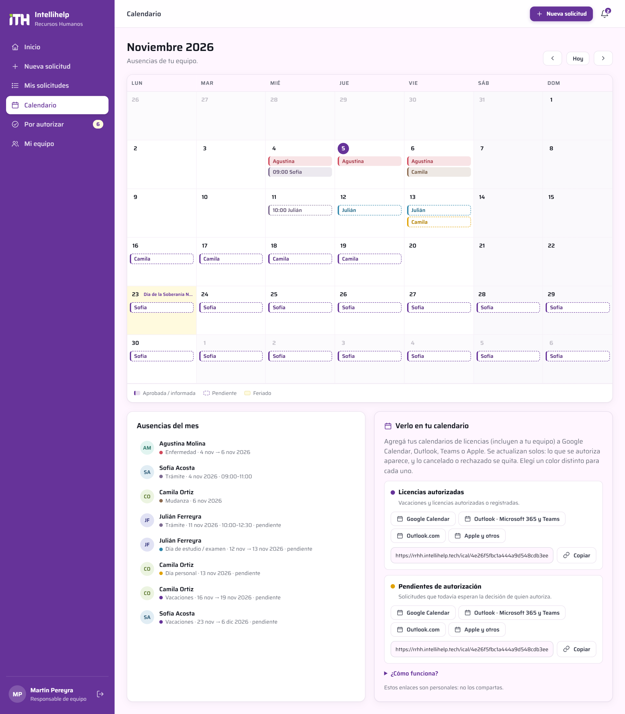</td>
    <td width="50%"><b>Todas las licencias (filtros y exportación CSV)</b><br>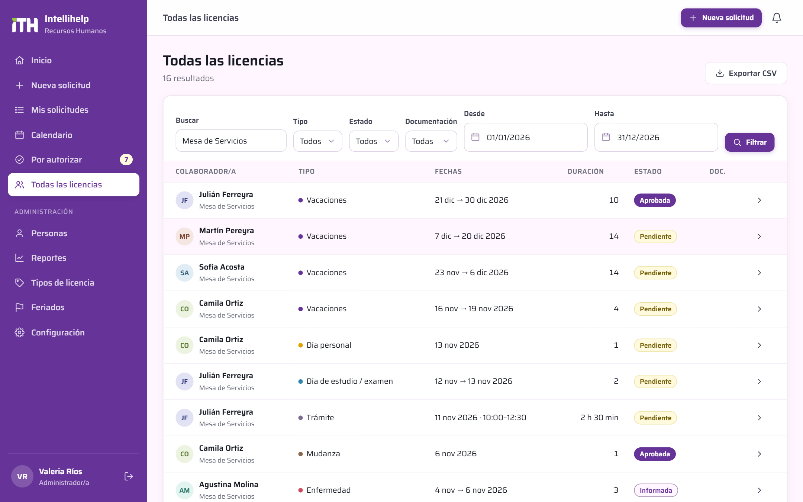</td>
  </tr>
  <tr>
    <td width="50%"><b>Personas</b><br>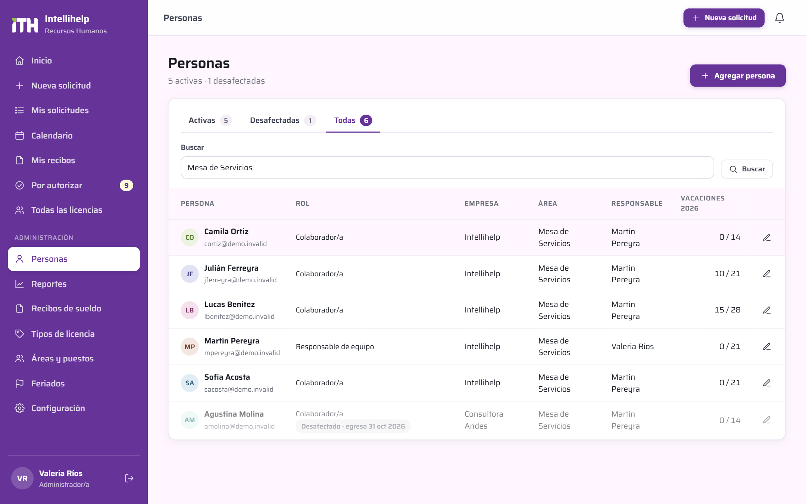</td>
    <td width="50%"><b>Tipos de licencia configurables</b><br>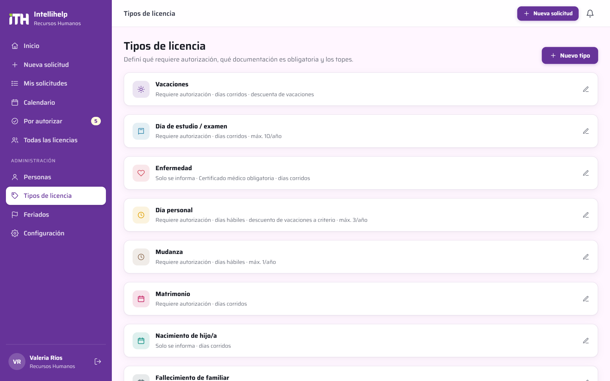</td>
  </tr>
</table>

### Ficha de la persona y legajo electrónico

Área y puesto se eligen de listas, con los puestos de cada área, y si no están se elige **Otro** y se escribe a mano. Las listas se administran en **Administración → Áreas y puestos**: 23 áreas y 316 puestos iniciales, con las áreas según el Clasificador Nacional de Ocupaciones del INDEC (CNO-17) y los puestos según la CIUO-08 de la OIT, con los nombres que se usan en los avisos del mercado laboral. RRHH puede agregar, renombrar o eliminar cualquiera; al renombrar se actualiza la ficha de quienes lo tienen. El **convenio colectivo** se elige entre los convenios nacionales de actividad, verificados en el [buscador oficial del Ministerio](https://convenios.trabajo.gob.ar/ConsultaWeb/consultaBasica.asp). Cualquier otro se carga con su número oficial (por ejemplo, 130/75), y cada convenio muestra sus **categorías oficiales**: las del CCT 130/75 salen de la escala FAECYS de octubre de 2026. Los teléfonos y los nombres se guardan siempre con el mismo formato, se escriban o se peguen como sea: `+54 9 11 5769-0543`.

El portal encuentra el **legajo electrónico** de cada persona en la carpeta de RRHH de Drive, respetando su estructura (`LEGAJOS ELECTRONICOS / grupo / NOMBRE`). Controla los 15 documentos de alta, crea la carpeta de quien ingresa y, al egreso, pasa el legajo a «1. DESAFECTADOS» y guarda el detalle de las vacaciones a liquidar en `LIQUIDACIONES / año / mes`.

<table>
  <tr>
    <td width="50%"><b>Datos de la persona</b><br>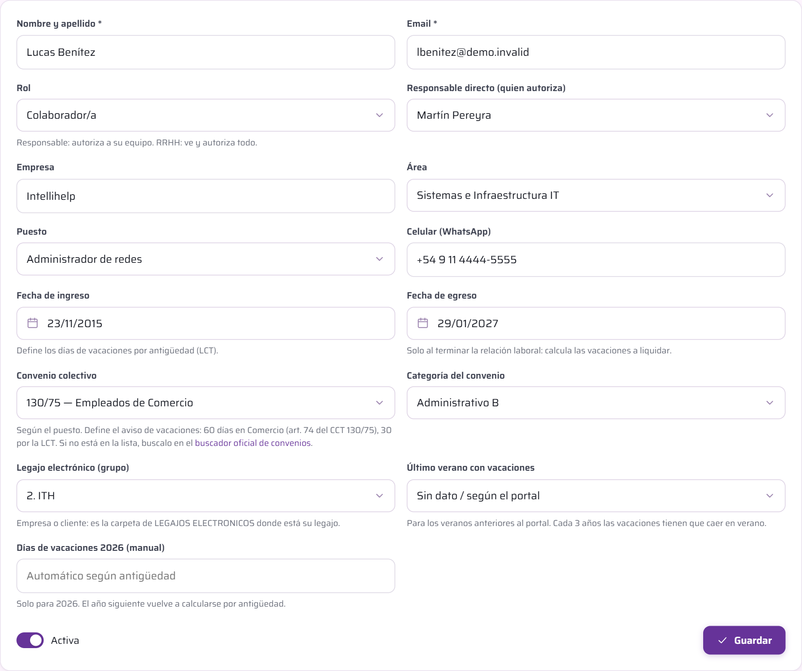</td>
    <td width="50%"><b>Legajo electrónico y documentación de alta</b><br>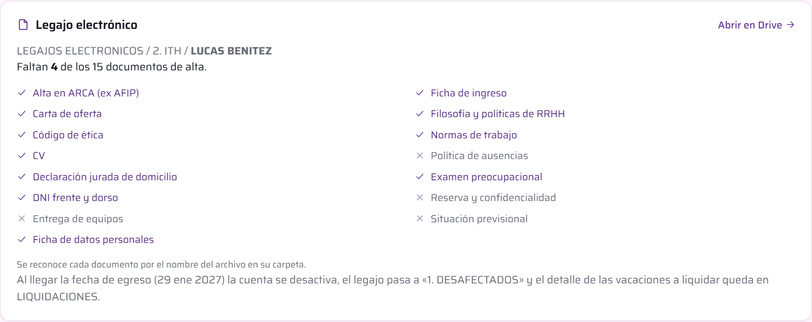</td>
  </tr>
</table>

### Recibos de sueldo

Los recibos se cargan tal como los emite el estudio contable: un PDF por persona (por ejemplo, «20.Junio 2026 Brian Sierra.pdf») o el archivo del mes con todos. El portal reconoce el formato actual y el anterior y lee de cada uno el CUIL, el nombre, el legajo, el período (mes, aguinaldo, liquidación final), la fecha de pago y el neto. Identifica a la persona por su CUIL (la primera vez, por su nombre, y le completa el CUIL y el legajo en la ficha) y guarda el recibo en su legajo electrónico (`Recibos de Sueldo / año`); los que no puede identificar quedan para asignar a mano.

En **Mis recibos** cada persona ve, descarga y firma sus recibos de conformidad o en disconformidad, con el motivo (LCT arts. 138 a 146). El portal estampa la firma electrónica en el recuadro «FIRMA DEL EMPLEADO», con fecha, hora y código de verificación del archivo original, y guarda la copia firmada junto al original. **En prueba:** por ahora «Mis recibos» lo ven solo los administradores; se habilita para todo el personal desde Configuración.

Si el recibo llega con la **firma digital de la empresa** (PAdES), el portal la verifica al cargarlo: que el archivo no se haya modificado después de firmado y que el certificado pertenezca a un certificador licenciado (AC Raíz de la República Argentina, en `app/certs`). Un recibo alterado no se carga. En ese caso la conformidad del trabajador queda en una **constancia aparte**, que identifica el recibo por su código SHA-256, para no alterar la firma de la empresa.

**Marco legal:** LCT art. 138 (recibo firmado por el trabajador), art. 139 según la Ley 27.802 (entrega mediante un sistema que permita su firma digital o electrónica), art. 143 según la Ley 27.802 (conservación de 2 años, y de 10 para obligaciones previsionales; los recibos digitalizados tienen la misma validez que en papel), Res. MTEySS 346/2019 (recibos digitales sin autorización previa, firma en disconformidad, descarga y copia por el trabajador) y Ley 25.506 de firma digital.

<table>
  <tr>
    <td width="50%"><b>Carga y control (administradores)</b><br>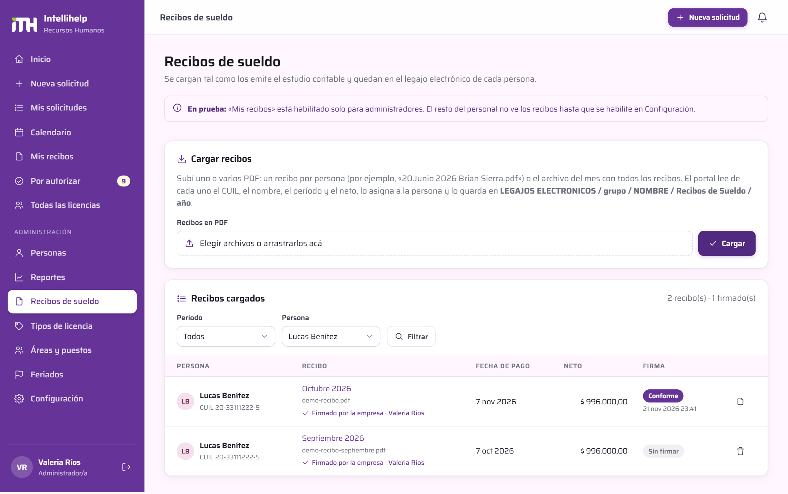</td>
    <td width="50%"><b>Mis recibos</b><br>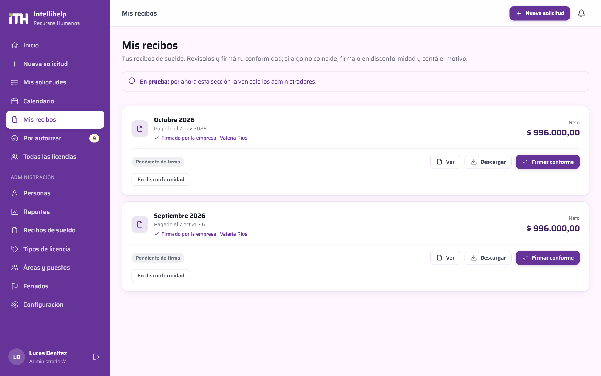</td>
  </tr>
  <tr>
    <td colspan="2"><b>Recibo firmado electrónicamente (recibo ficticio)</b><br>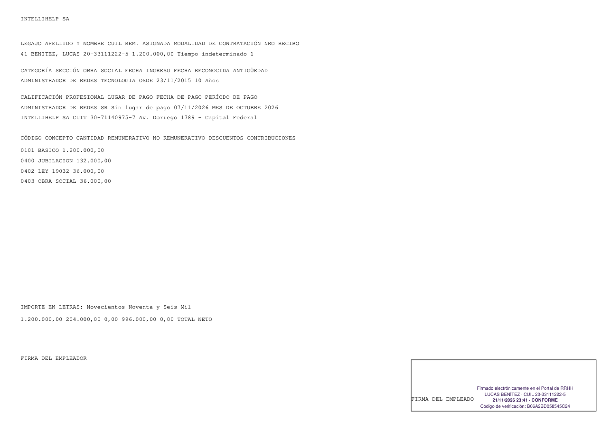</td>
  </tr>
</table>

### Áreas y puestos

<table>
  <tr>
    <td width="50%"><b>Listado de áreas</b><br>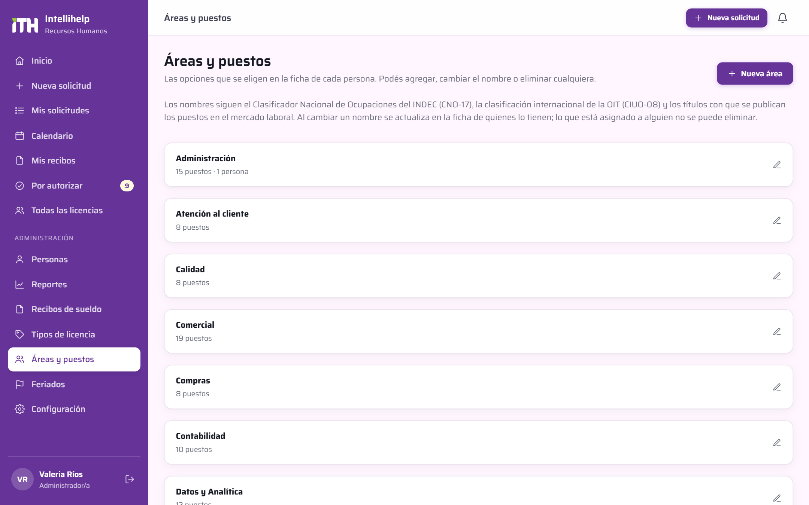</td>
    <td width="50%"><b>Edición de un área y sus puestos</b><br>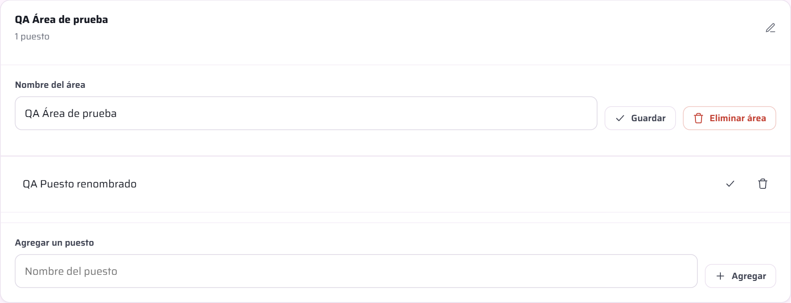</td>
  </tr>
</table>

### Confirmaciones y validaciones propias

Ninguna ventana del navegador: las confirmaciones, los mensajes de los campos obligatorios, las listas, los calendarios y el selector de color tienen el diseño del portal.

<table>
  <tr>
    <td width="50%"><b>Confirmación</b><br>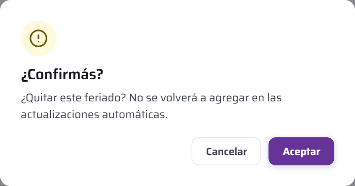</td>
    <td width="50%"><b>Campo obligatorio</b><br>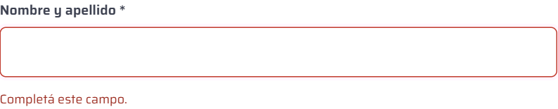</td>
  </tr>
</table>

### Reportes (administradores)

Licencias aprobadas que impactan en vacaciones, con filtros por período y persona, **descarga en Excel con formato de tabla** y envío mensual automático por correo.

<p align="center">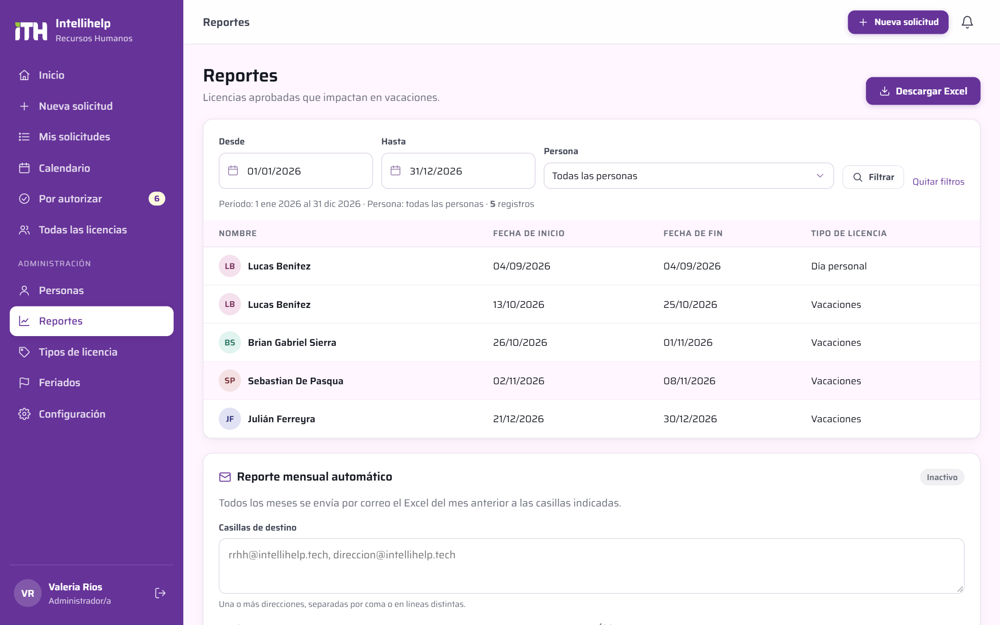</p>

### Celular

<p align="center">
  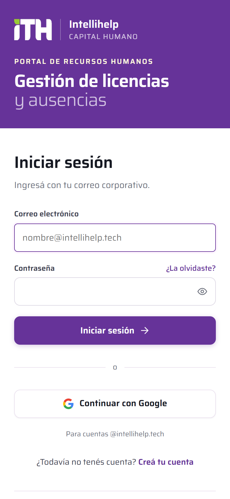
  &nbsp;
  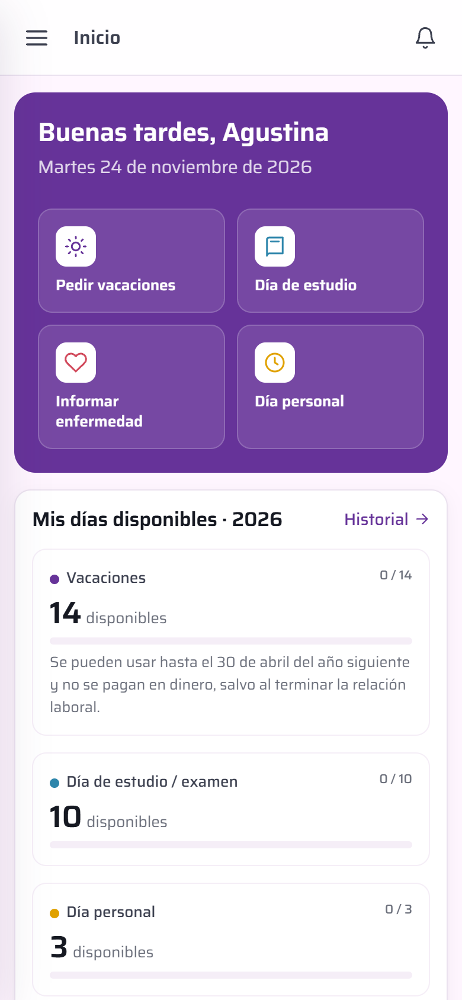
  &nbsp;
  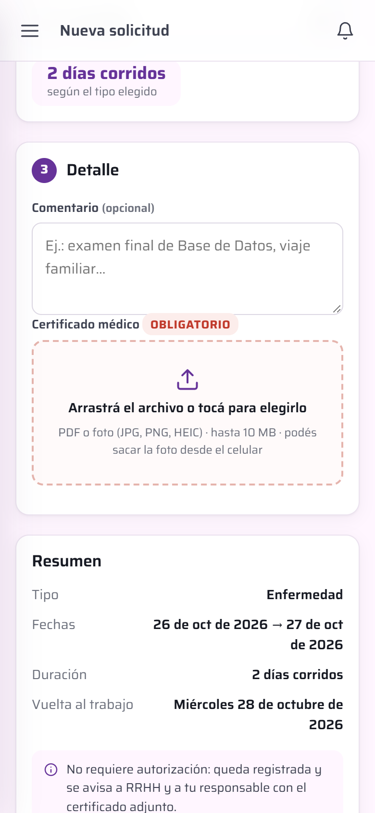
</p>

### Sincronización con Google Calendar, Outlook y Teams

Cada persona agrega sus calendarios de licencias en un clic: uno con las **autorizadas** y otro con las **pendientes**, para verlos con colores distintos. Funcionan con Google Calendar, Outlook (Microsoft 365 y Outlook.com), Teams y Apple, y se actualizan solos.

<p align="center">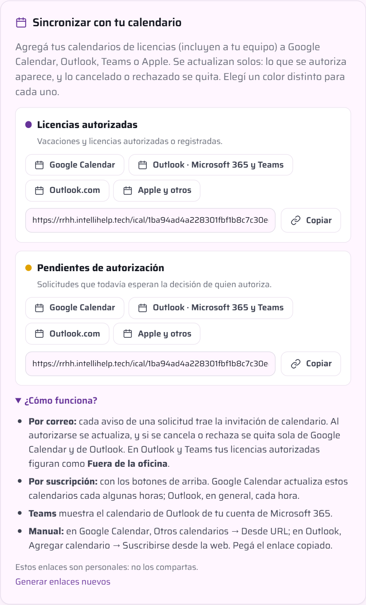</p>

### Email de notificación

<p align="center">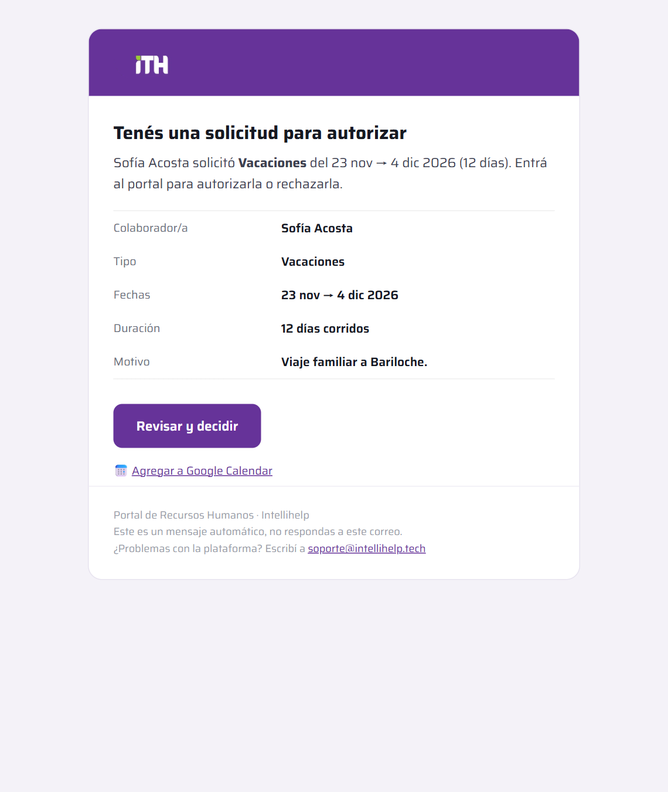</p>

## Funcionalidades

### Colaboradores
- Solicitud de **vacaciones, días de estudio/examen, día personal, trámites, mudanza, matrimonio, nacimiento, fallecimiento, maternidad, donación de sangre** y **enfermedad**.
- **Trámites por horario**: día en un calendario y horario de salida y regreso; no impactan en las vacaciones.
- Cálculo automático de días **corridos o hábiles**, descontando fines de semana y **feriados nacionales**.
- **Días disponibles** por tipo de licencia; vacaciones calculadas según antigüedad conforme a la **LCT (art. 150)**: 14, 21, 28 o 35 días, con el proporcional del art. 153 y los días acumulados por acuerdo (art. 164).
- **Vacaciones por semanas completas**: la semana termina siempre el domingo y los feriados posteriores completan la semana. Los pedidos fuera del período habitual requieren doble confirmación y quedan marcados para quien autoriza.
- **Ingreso con Google** para las cuentas del dominio corporativo, además del ingreso con correo y contraseña.
- Solo las vacaciones descuentan días de vacaciones; en el **día personal**, quien autoriza decide si se descuenta.
- La documentación (certificados y constancias) se entrega **después** de pedir la licencia: una vez autorizada o, si solo se informa, cuando se tenga, dentro de un **plazo** con recordatorio previo.
- Validaciones: superposición de fechas, topes anuales y por solicitud, anticipación sugerida.
- Entrega de **certificados y constancias** en **PDF, JPG o PNG**, también desde la cámara del celular.
- La documentación se guarda en **Google Drive**, ordenada en `Nombre y Apellido / Año / Tipo de licencia / AAAAMMDD.ext`, renombrada con la fecha de carga.
- Historial completo, cancelación de solicitudes y notificaciones dentro del portal.
- **Calendarios sincronizados** con Google Calendar, Outlook, Teams y Apple: autorizadas y pendientes por separado, cada una con su color.
- Cada correo trae la **invitación de calendario**: al autorizarse se actualiza y, si se cancela o rechaza, se quita sola. En Outlook y Teams las licencias propias figuran como *Fuera de la oficina*.

### Responsables y Recursos Humanos
- Bandeja **Por autorizar** con aprobación en un clic; el rechazo exige un motivo.
- **Descuento opcional de vacaciones** en el día personal, validando los días disponibles del colaborador.
- **Excepciones de vacaciones a criterio**: en los pedidos fuera del período habitual, quien autoriza elige computar solo los días pedidos o la semana completa.
- Alerta de **superposición** con otras ausencias del equipo o del área.
- Verificación u **observación de documentación**; una observación otorga un nuevo plazo de 2 días hábiles.
- **Plazos de entrega de documentación** en días hábiles: automáticos según el tipo de licencia (contados desde el fin de la licencia o desde que se informa, nunca antes de que termine) o fijados por quien autoriza; aviso al colaborador antes del vencimiento y aviso al responsable y RRHH si vence.
- **Calendario** mensual de ausencias y listado general con **filtros y exportación CSV**.
- **Recordatorios automáticos** de solicitudes pendientes.
- Carga de licencias en nombre de un colaborador (con aprobación directa opcional).

### Administración
- Alta de **personas** con rol, responsable directo, empresa, área y puesto (de listas, con opción de escribir otro), fecha de ingreso y egreso, convenio colectivo y su categoría oficial, grupo del legajo, último verano con vacaciones y días de vacaciones manuales opcionales. La ficha registra los acuerdos de acumulación y calcula las vacaciones a liquidar al egreso.
- **Legajo electrónico** en Google Drive: vínculo automático con la carpeta de cada persona, control de los 15 documentos de alta, creación de la carpeta al ingreso y, al egreso, cuenta desactivada, legajo a «1. DESAFECTADOS» y detalle de vacaciones a liquidar en LIQUIDACIONES.
- **Formatos unificados**: teléfonos en formato internacional (`+54 9 11 5769-0543`) y nombres con mayúsculas iniciales, sin importar cómo se escriban o peguen.
- **Autoregistro** de colaboradores: los correos del dominio corporativo se activan solos; los de **personal tercerizado** quedan pendientes de aprobación por RRHH.
- Cuentas sin confirmar: **reenvío del correo de confirmación** (también desde «¿La olvidaste?»), habilitación con contraseña temporal y eliminación de registros duplicados o con el correo mal escrito.
- **Recibos de sueldo** (en prueba, solo administradores): carga de los PDF del estudio contable, identificación por CUIL, guardado en el legajo electrónico y firma de conformidad con sello en el recibo.
- **CUIL y N.º de legajo** en la ficha, con el formato oficial y validación del dígito verificador.
- **Áreas y puestos** configurables (CNO-17 del INDEC y CIUO-08 de la OIT), con opción de escribir otro en la ficha.
- **Tipos de licencia** configurables: autorización, documentación obligatoria y su plazo de entrega, topes, forma de conteo, regla del fin de semana, descuento de vacaciones y color.
- **Reportes** (solo administradores): exportación a Excel de las licencias que impactan en vacaciones y envío mensual automático a una o más casillas.
- **Feriados nacionales actualizados solos**: cada día se consulta el calendario oficial del año en curso y del siguiente. Se agregan los días puente y los feriados por decreto, los trasladables se reubican cuando se fija su fecha y RRHH recibe un correo con cada cambio y las solicitudes que conviene revisar. Se pueden sumar feriados provinciales a mano, indicando dónde rigen (por ejemplo, «solo Provincia de Buenos Aires»), para que se distingan de los nacionales en el calendario y en las solicitudes, y quitar un día puente que la empresa trabaja, sin que vuelva a agregarse.
- Configuración de **canales de notificación** con pruebas integradas (email, Google Chat, Google Calendar).

### Roles

| Rol | Alcance |
|---|---|
| Colaborador/a | Pide y consulta sus propias licencias |
| Responsable de equipo | Autoriza a su equipo y ve su calendario |
| Recursos Humanos | Ve y autoriza todo, verifica documentación, administra personas y tipos |
| Administrador/a | Todo lo anterior más la configuración del sistema y los reportes |

## Circuito de una solicitud

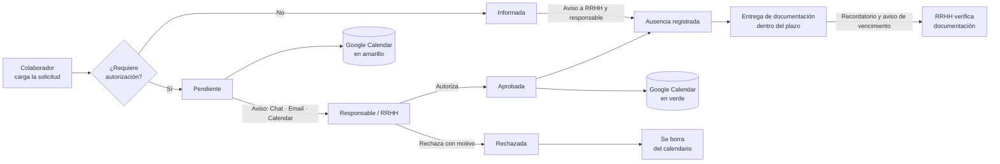

| Estado | Significado | En Google Calendar |
|---|---|---|
| Pendiente | Espera la decisión del responsable | 🟡 `⏳ [Pendiente] Tipo — Persona` |
| Aprobada | Autorizada (indica si se descontó de vacaciones) | 🟢 `Tipo — Persona` |
| Informada | Licencia sin autorización (ej. enfermedad) | 🟣 `Tipo — Persona` |
| Rechazada / Cancelada | Sin efecto | Se elimina |

## Notificaciones

| Canal | Destinatarios | Contenido |
|---|---|---|
| **Portal** | Todos | Avisos con acceso directo a la solicitud |
| **Email** | Colaborador, aprobadores y casilla de RRHH | Detalle de la solicitud, botón de acción e invitación de calendario que se actualiza o se quita según el estado |
| **Google Chat** | Espacio de aprobadores | Nuevas solicitudes, licencias informadas, certificados, decisiones y recordatorios |
| **Google Calendar** | Calendario compartido de licencias | Evento por solicitud: violeta si está autorizada, amarillo si está pendiente; se elimina al cancelarse o rechazarse |
| **Calendarios publicados** | Cada persona (Google, Outlook, Teams, Apple) | Licencias autorizadas y pendientes en dos calendarios separados, con actualización automática |

La integración con Google Calendar usa una **cuenta de servicio** con **delegación de todo el dominio**, por lo que no requiere compartir el calendario con cuentas externas a la organización.

## Arquitectura

Aplicación **PHP 8.3 sin framework**, pensada para hosting compartido: sin procesos residentes ni dependencias de compilación.

```
├── app/                    # Fuera del docroot (no accesible desde la web)
│   ├── bootstrap.php       # Carga de configuración y librerías
│   ├── routes.php          # Rutas y despacho
│   ├── controllers/        # Autenticación, registro, solicitudes, calendario, perfil, administración
│   ├── lib/
│   │   ├── leave.php       # Reglas de negocio: conteo de días, vacaciones LCT, etapas, validaciones
│   │   ├── notify.php      # Orquestación de notificaciones por evento
│   │   ├── gcal.php        # Autenticación de Google (JWT) y Google Calendar
│   │   ├── gdrive.php      # Almacenamiento de la documentación en Google Drive
│   │   ├── reports.php     # Reportes de vacaciones en Excel y envío mensual
│   │   ├── legajos.php     # Legajos electrónicos, egresos y carpetas de RRHH en Drive
│   │   ├── catalogs.php    # Áreas, puestos, convenios colectivos y categorías
│   │   ├── payslips.php    # Recibos de sueldo: lectura, legajo y firma
│   │   ├── mailer.php      # Envío SMTP y plantilla de email
│   │   ├── gchat.php       # Notificaciones a Google Chat
│   │   ├── http.php        # Cliente HTTP (cURL)
│   │   ├── ics.php         # Invitaciones y feeds iCalendar
│   │   └── whatsapp.php    # Conectores opcionales de WhatsApp
│   ├── views/              # Plantillas PHP
│   ├── sql/                # Esquema, datos iniciales y migraciones idempotentes
│   ├── certs/              # Certificados oficiales de la AC Raíz de la República Argentina
│   ├── cron.php            # Recordatorios, feriados, egresos y reporte mensual
│   └── install.php         # Instalador por línea de comandos
├── public_html/            # Docroot: front controller, .htaccess y assets (ui.js: calendario y listas)
└── docs/                   # Banner y capturas
```

| Capa | Tecnología |
|---|---|
| Backend | PHP 8.3 (PDO, cURL, OpenSSL, fileinfo) |
| Base de datos | MariaDB 11 / MySQL 8 |
| Email | PHPMailer (SMTP de Google Workspace) |
| Documentación | Google Drive API (estructura por persona, año y tipo de licencia) |
| Reportes | PhpSpreadsheet (Excel con formato de tabla) |
| Integraciones | Google Calendar API, Google Chat Webhooks, iCalendar |
| Frontend | HTML + CSS propio + JavaScript sin dependencias |
| Identidad | Tipografía Saira · paleta `#663399` · `#9f88b1` · `#fff6ff` · `#fffade` · colores planos |

## Seguridad

- Contraseñas con `password_hash` (bcrypt/argon) y política de complejidad.
- Protección **CSRF** en todos los formularios y cookies de sesión `HttpOnly`, `Secure` y `SameSite`.
- Consultas **parametrizadas** (PDO) y escape de salida en todas las vistas.
- **Bloqueo por intentos fallidos** de ingreso y de recuperación de contraseña.
- Documentación almacenada en **Google Drive** (nunca en el servidor web), servida desde el portal solo a usuarios autorizados; se valida el tipo real del archivo (PDF, JPG o PNG) y su tamaño.
- **Secretos cifrados** en base de datos (AES-256-GCM): contraseña SMTP, clave de la cuenta de servicio, webhooks.
- Validación de correo por enlace en el autoregistro y aprobación manual para dominios externos.
- HTTPS forzado, HSTS y cabeceras `X-Frame-Options`, `X-Content-Type-Options` y `Referrer-Policy`.

## Instalación y despliegue

### Requisitos
- PHP 8.2+ con `pdo_mysql`, `curl`, `openssl`, `mbstring`, `fileinfo`
- MariaDB 10.6+ o MySQL 8
- Composer

### Pasos

```bash
# 1. Subir app/ y public_html/ al servidor
#    (public_html/ como docroot; app/ al mismo nivel, fuera de la web)

# 2. Configuración
cp app/config.sample.php app/config.php
#    completar credenciales de base de datos y app_key (64 caracteres hex):
php -r "echo bin2hex(random_bytes(32)), PHP_EOL;"

# 3. Dependencias
cd app && composer install --no-dev

# 4. Base de datos y usuario administrador (idempotente: también aplica migraciones)
php install.php "Nombre Apellido" admin@intellihelp.tech
```

### Tarea programada

Ejecutar cada hora (en hPanel: **Avanzado → Cron Jobs**):

```
/usr/bin/php /home/<usuario>/domains/rrhh.intellihelp.tech/app/cron.php
```

Envía recordatorios de solicitudes pendientes y reintenta la sincronización con Google Calendar.

## Configuración

Todo se configura desde **Administración → Configuración**, sin tocar código:

| Sección | Parámetros |
|---|---|
| General | Nombre de la empresa, correo de soporte, casilla de RRHH, aprobador por defecto, frecuencia de recordatorios |
| Registro | Habilitar autoregistro, dominios de confianza |
| Email | Servidor SMTP, remitente, alcance de los avisos |
| Google Calendar | ID del calendario, clave JSON de la cuenta de servicio, usuario a representar |
| Google Drive | ID de la carpeta raíz de la documentación y de las carpetas de RRHH, LEGAJOS ELECTRONICOS y LIQUIDACIONES |
| Google Chat | Webhook del espacio de aprobadores |

<details>
<summary><b>Configurar Google Calendar</b></summary>

1. En Google Cloud: crear un proyecto, habilitar **Google Calendar API** y crear una **cuenta de servicio** con clave JSON.
2. En la Consola de administración de Google Workspace: **Seguridad → Controles de API → Delegación de todo el dominio**, autorizar el *Client ID* de la cuenta de servicio con el permiso `https://www.googleapis.com/auth/calendar`.
3. Crear el calendario compartido de licencias y compartirlo con quienes autorizan.
4. En el portal: cargar el ID del calendario, la clave JSON y el usuario dueño del calendario en «Actuar en nombre de».
5. **Probar Google Calendar** crea un evento de prueba; después de verlo en el calendario, **Finalizar test** lo elimina.

</details>

<details>
<summary><b>Configurar Google Drive</b></summary>

1. En el proyecto de Google Cloud: habilitar **Google Drive API**.
2. En la delegación de todo el dominio de la cuenta de servicio, agregar el permiso `https://www.googleapis.com/auth/drive` (junto al de Calendar).
3. El usuario representado debe poder crear contenido en la carpeta raíz.
4. En el portal: cargar el ID de la carpeta (la parte final de su enlace) y usar **Probar Google Drive**.

Estructura generada automáticamente:

```
Carpeta raíz/
└── Nombre y Apellido/
    └── 2026/
        ├── Vacaciones/
        ├── Día de estudio / examen/
        │   └── 20261029.pdf
        ├── Enfermedad/
        │   ├── 20261020.jpg
        │   └── 20261020-2.pdf
        └── … (una carpeta por cada tipo de licencia)
```

</details>

<details>
<summary><b>Configurar Google Chat</b></summary>

1. Crear un espacio (por ejemplo, «RRHH – Aprobaciones») y sumar a quienes autorizan.
2. En el espacio: **Apps e integraciones → Webhooks → Agregar webhook** y copiar la URL.
3. Pegarla en el portal y usar **Probar Google Chat**.

</details>

## Autor

**Brian Sierra** — Administrador de sistemas (SysAdmin) en Intellihelp · [LinkedIn](https://www.linkedin.com/in/brian-gabriel-sierra/) · [GitHub](https://github.com/bsierra4262)

Diseño, desarrollo e implementación completos: circuito de solicitudes y aprobaciones, saldos de días, avisos por Google Chat, email y Google Calendar, historial con documentación respaldatoria y despliegue.

---

<p align="center">
  <sub>© 2026 Intellihelp · Software de uso interno. Todos los derechos reservados.</sub>
</p>
